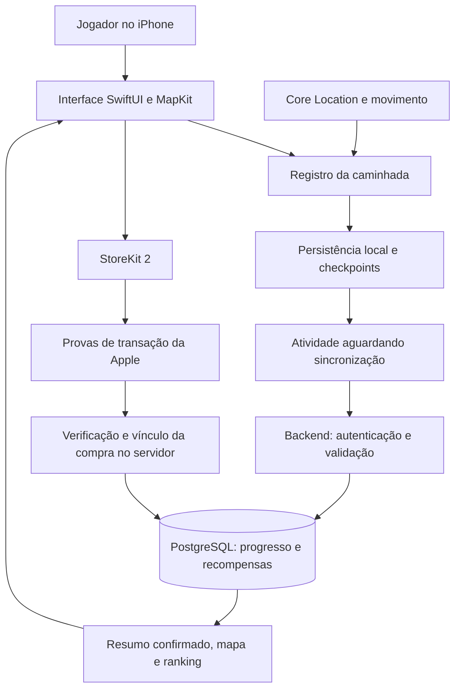

# Arquitetura do WalkZone

Visão conceitual das responsabilidades do sistema. Este documento não publica URLs internas, chaves, esquemas completos ou instruções de acesso à produção.

## App iOS

A interface apresenta estado de atividade, territórios, perfil, loja e progresso. O registro usa localização e movimento; persistência local por conta e checkpoints ajudam a preservar dados coletados. Operações em andamento precisam respeitar mudanças de sessão para que uma resposta antiga não seja aplicada a outra conta.

## Backend

As funções de borda recebem requisições autenticadas. O servidor valida atividades e aplica as regras de progresso e recompensas. O PostgreSQL centraliza os resultados compartilhados usados no mapa e no ranking. Políticas de acesso e funções restritas limitam quem pode consultar ou alterar dados.

## Fluxo de uma caminhada

1. O usuário inicia uma atividade explicitamente.
2. O app coleta e persiste pontos e informações da atividade.
3. Ao finalizar, preserva os dados necessários ao envio.
4. O servidor valida e calcula o resultado territorial e as recompensas.
5. A interface atualiza o resumo e o estado compartilhado após a confirmação.
6. Em falhas transitórias, a atividade fica pendente para nova tentativa com o app aberto.

Um resultado pendente não deve ser apresentado como ganho confirmado. Recuperação e reenvio também não devem conceder moedas duplicadas.

## Fluxo comercial

A compra é iniciada pelo StoreKit. O backend verifica a prova da transação e seu ambiente, produto, validade e vínculo com a conta antes da aplicação do benefício. O processamento considera repetição de transações e impede que a mesma propriedade seja reutilizada por outra conta.

Sandbox é um ambiente de teste: a validade acelerada de uma assinatura não equivale à duração comercial real. A separação entre teste e produção também se aplica ao saldo de compras.

## Limites desta visão

O diagrama não representa todos os serviços nem demonstra disponibilidade, escalabilidade ou segurança certificadas. O sistema permanece em evolução, e validação de GPS e comportamento em segundo plano exigem testes em dispositivos físicos.
