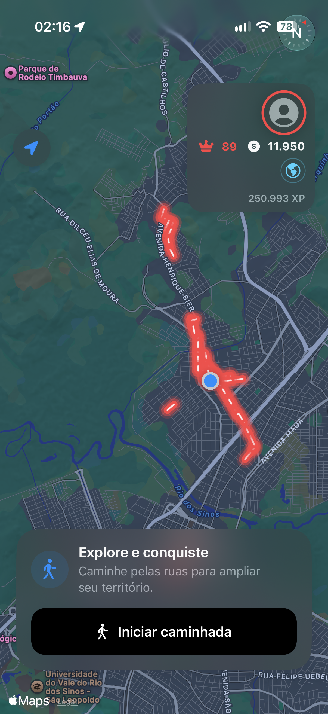
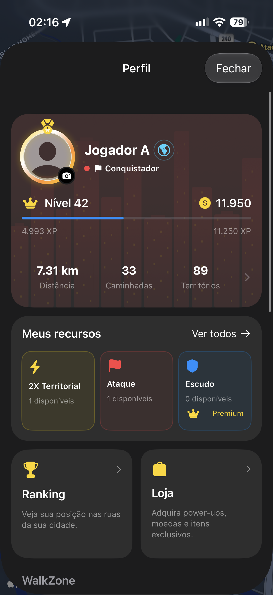
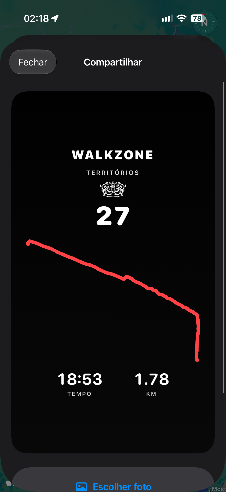
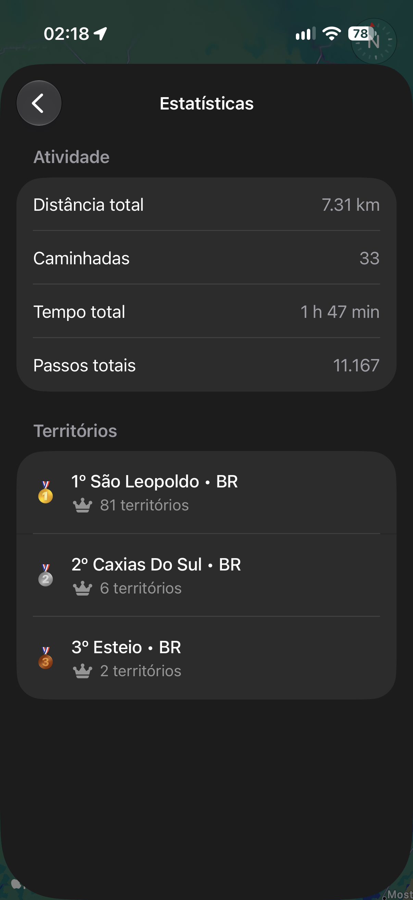
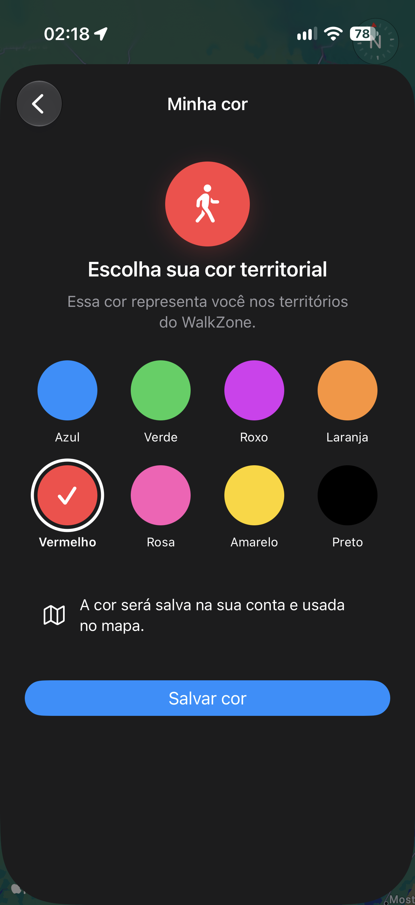
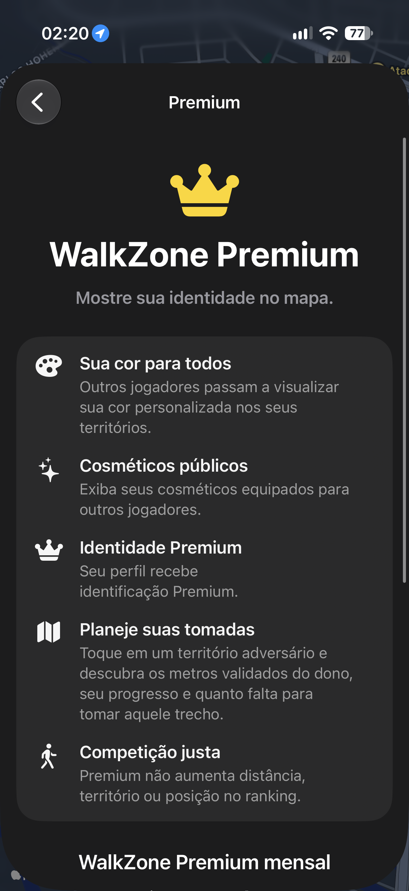

# WalkZone
### Caminhe. Conquiste. Domine.

Aplicativo nativo para iPhone que transforma caminhadas em uma disputa por territórios virtuais nas ruas da cidade.

**Swift · SwiftUI · MapKit · Core Location · StoreKit 2 · Supabase · PostgreSQL · TypeScript**

[Site do projeto](https://www.walkzone.com.br) · [Architecture / Arquitetura](ARCHITECTURE.md) · [Decisões de engenharia](ENGINEERING.md) · [English](README.en.md)

## Sobre o projeto

O WalkZone conecta atividade física, geolocalização e competição local. O jogador inicia uma caminhada, registra seu trajeto, acumula progresso em segmentos de ruas e acompanha os territórios confirmados pelo servidor. O mapa competitivo e o ranking por cidade tornam esse progresso visível no jogo.

Este repositório apresenta o produto e sua engenharia para fins de portfólio. O aplicativo e os serviços de produção permanecem em repositórios privados. Não é um projeto executável nem um pacote de instalação.

**Autor e responsável pelo produto:** [Jonathan Amaral](https://github.com/Amaral-sci).

**Situação em 26/10/2026:** distribuído a testadores pelo TestFlight; versão 1.0, build 20, reenviada à revisão da App Store após ajuste dos metadados. A aprovação e a publicação ainda não estão confirmadas.

## Experiência do jogador

- **Caminhadas com GPS:** distância, duração, passos, ritmo, velocidade e visualização do percurso.
- **Territórios nas ruas:** conquistas, manutenção e disputa de trechos, com validação no backend.
- **Competição por cidade:** mapa com territórios de participantes e ranking local.
- **Progressão:** experiência, níveis e moedas virtuais acumuladas por marcos de atividade e conquistas.
- **Personalização:** cores territoriais, títulos e cosméticos de perfil e mapa.
- **Premium opcional:** aparência pública personalizada e informações de distância para planejar disputas de territórios.
- **Conta e privacidade:** acesso por e-mail e Apple, modo convidado e fluxo de exclusão de conta.

## O app em imagens

Capturas reais do aplicativo em testes. Os valores representam o estado da conta de teste no momento da captura; não são indicadores de escala ou de desempenho do produto.

<table>
<tr>
<td align="center"> <b>Conquiste territórios</b></td>
<td align="center"> <b>Evolua seu perfil</b></td>
<td align="center"> <b>Compartilhe conquistas</b></td>
</tr>
<tr>
<td align="center"> <b>Acompanhe sua atividade</b></td>
<td align="center"> <b>Personalize sua identidade</b></td>
<td align="center"> <b>Explore o Premium</b></td>
</tr>
</table>

## Tecnologias e responsabilidades

| Camada | Tecnologias | Papel no projeto |
| --- | --- | --- |
| Interface iOS | Swift, SwiftUI | Navegação, mapa, perfil, loja e resumos de caminhada |
| Mapas e sensores | MapKit, Core Location, Core Motion | Exibição geográfica, localização e sinais de movimento |
| Persistência no aparelho | SwiftData e arquivos de checkpoint | Estado local por conta e recuperação de atividades interrompidas |
| Identidade | Sign in with Apple, Supabase Auth | Sessão e vinculação do progresso à conta |
| Backend | Supabase Edge Functions, TypeScript | Validação de atividades, sincronização e verificação de compras |
| Dados | PostgreSQL, funções SQL, RLS | Progresso territorial, recompensas e controle de acesso |
| Compras | StoreKit 2, verificações de transações Apple no servidor | Assinatura e moedas virtuais, com separação de Sandbox e produção |
| Distribuição | Xcode, TestFlight, App Store Connect | Build, archive, testes com usuários e submissão para revisão |

## Desafios de engenharia

### Preservar uma caminhada durante interrupções
O registro de atividade precisa tolerar a tela bloqueada e a interrupção do processo. O projeto utiliza checkpoints locais e um registro incremental para recuperar o que já foi persistido. Isso reduz o risco de perder o progresso coletado; não implica que o iOS continuará entregando GPS após qualquer encerramento do app.

### Sincronizar sem duplicar recompensas
O aparelho registra a atividade e o servidor valida o progresso e as recompensas. Reenvios devem tratar a mesma operação como a mesma operação, em vez de creditar novamente. Essa separação também permite mostrar que uma atividade está pendente antes da confirmação.

### Vincular compras à conta correta
Uma confirmação da Apple precisa ser verificada e associada à conta WalkZone correta antes de liberar benefícios. O backend verifica as transações e preserva a vinculação de propriedade. Compras de teste e produção possuem tratamentos separados.

### Equilibrar mapa, navegação e consumo de recursos
Um mapa com territórios e cosméticos exige cuidado com atualizações e renderização. Foram introduzidos controles para reduzir trabalho de apresentação quando o mapa está coberto por outras telas, preservando o fluxo de uma caminhada ativa. O comportamento térmico continua dependendo de testes em aparelhos reais.

Mais detalhes em [Decisões de engenharia](ENGINEERING.md).

## Qualidade e validação

O projeto inclui testes de políticas de autenticação e compras, recuperação de checkpoints, verificação de provas de transação, tratamento de reenvios e operações SQL com rollback para validação de atomicidade. A documentação deste repositório resume essas práticas; não disponibiliza a suíte privada nem apresenta um selo de CI público.

Nos testes com participantes, foram exercitados sincronização de caminhadas, exclusão de conta, resgate Premium e visualização dos benefícios em outro aparelho. Isso não substitui uma auditoria independente nem comprova ausência de falhas. Testes prolongados de GPS, consumo e compras continuam fazendo parte da evolução do produto.

## Meu papel e processo

Concepção e condução do produto, definição das regras de território e progressão, priorização de funcionalidades, organização dos testes com usuários e preparação da distribuição iOS. O desenvolvimento contou com ferramentas de assistência por IA para implementação, investigação de falhas, testes e documentação.

O estudo de caso destaca as decisões e os resultados observáveis, sem atribuir ao projeto métricas de usuários, desempenho ou estabilidade que não foram medidas.

## O que posso demonstrar em uma entrevista

- Fluxo completo de uma caminhada e confirmação territorial.
- Diferença entre estado local, sincronização pendente e resultado validado pelo servidor.
- Decisões de recuperação de atividade e isolamento de dados por conta.
- Separação entre transação Apple, vínculo da compra e acesso às funcionalidades.
- Evolução do produto a partir de feedback real de testadores.

## Links

- [Site do WalkZone](https://www.walkzone.com.br)
- [Suporte](https://www.walkzone.com.br/suporte/)
- [Privacidade](https://www.walkzone.com.br/privacidade/)
- [Perfil profissional no GitHub](https://github.com/Amaral-sci)

## Direitos e escopo

Código de produção, credenciais, configurações internas e dados dos participantes não fazem parte deste repositório. As imagens mostram o aplicativo e podem incluir mapas e elementos de terceiros, sujeitos aos direitos de seus respectivos titulares. Não é concedida licença de uso ou redistribuição do aplicativo, da marca ou dos materiais por meio deste repositório.
